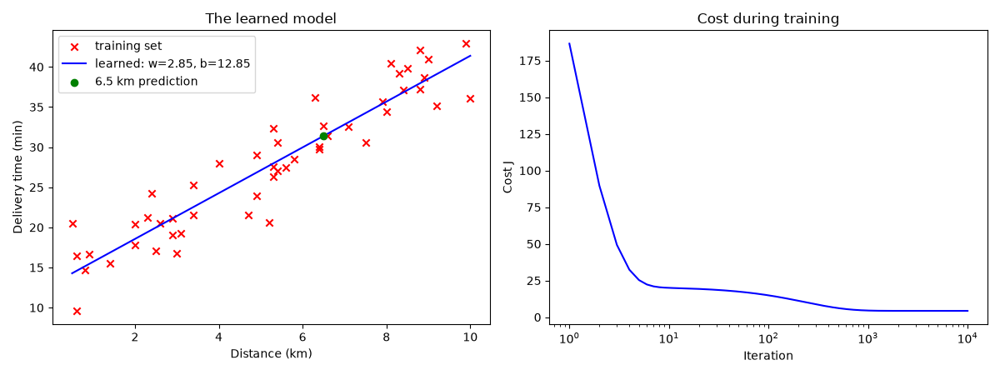
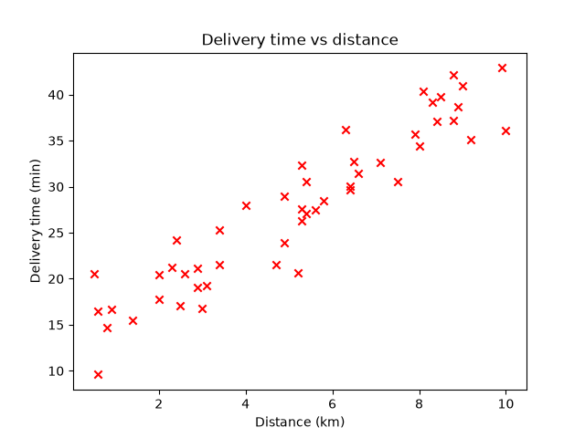
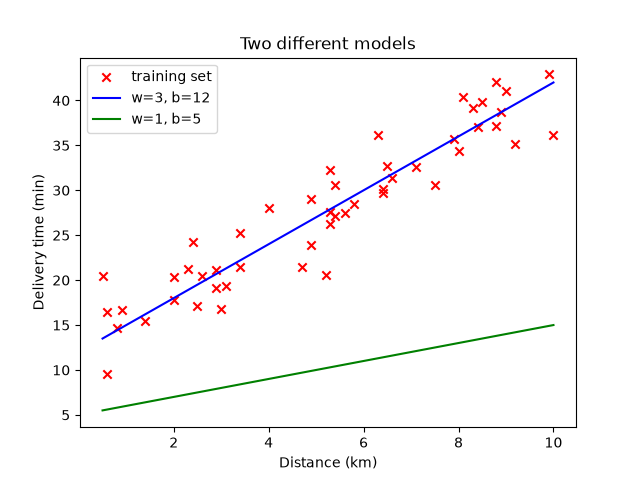
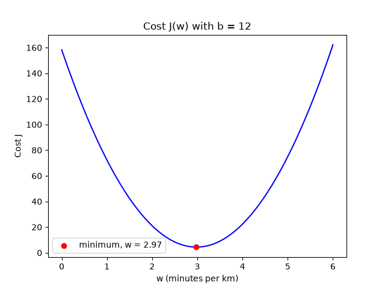

# Machine Learning from Scratch

Linear regression and gradient descent built from scratch in Python and NumPy: model, cost function, optimizer, tests and visualizations, in a step-by-step walkthrough.


<p align="center">
  
  <br>
  <sub>Learned line (left) and cost during training (right)</sub>
</p>


## Quick start

Requires [uv](https://docs.astral.sh/uv/) (installation in Step 1). Every
command runs from the project root.

**1. Set up the environment** (once):

```bash
uv sync
```

**2. Run everything:**

```bash
for f in scripts/*.py; do uv run "$f"; done
```

**3. Run the tests:**

```bash
uv run pytest
```

### Scripts

| Step | Command | What it does |
|---|---|---|
| 3 | `uv run scripts/03_training_set.py` | Prints the number of examples and the first one. Saves `figures/training_set.png` |
| 4 | `uv run scripts/04_model.py` | Predictions of two different lines for the first three deliveries |
| 5 | `uv run scripts/05_plot_model.py` | Draws two lines over the data. Saves `figures/plot_model.png` |
| 6 | `uv run scripts/06_cost.py` | Cost of three different lines |
| 7 | `uv run scripts/07_plot_cost.py` | Plots the cost as a function of `w`. Saves `figures/plot_cost.png` |
| 8 | `uv run scripts/08_gradient_step.py` | A single gradient descent step |
| 9 | `uv run scripts/09_gradient_descent.py` | Trains the model. Prints the learned `w`, `b` and the 6.5 km prediction |
| 10 | `uv run scripts/10_plot_result.py` | Learned line and cost during training. Saves `figures/plot_result.png` |
| 12 | `uv run scripts/12_multiple_features.py` | Deliveries with three features: the data matrix and the prediction `w · x + b` |
| 13 | `uv run scripts/13_vectorization.py` | Times a loop against the dot product, and the weight update both ways |

### Tests

| Command | What it does |
|---|---|
| `uv run pytest` | Runs all tests |
| `uv run pytest -v` | Same, listing each test by name |
| `uv run pytest tests/test_gradient.py` | Runs a single file |
| `uv run pytest -k one_step` | Runs the tests whose name contains `one_step` |

Expected result: `13 passed`.

### Expected results

| Check | Expected |
|---|---|
| Learned parameters (`09_gradient_descent.py`) | `w = 2.85`, `b = 12.85` |
| Prediction for 6.5 km | about 31.4 minutes |
| Tests | 13 passed |

---

## Step 1: Setting up the project with uv

[uv](https://docs.astral.sh/uv/) manages Python projects: it creates an
isolated environment for the project and installs the libraries it needs, so
nothing mixes with the rest of the computer.

Install it once per machine:

```bash
curl -LsSf https://astral.sh/uv/install.sh | sh
```

Create the project from inside its folder:

```bash
uv init --bare
```

This creates a single file, `pyproject.toml`, which describes the project:

```toml
[project]
name = "machine_learning_from_scratch"
version = "0.1.0"
requires-python = ">=3.12"
dependencies = []
```

Commands used throughout the project:

| Command | What it does |
|---|---|
| `uv run <command>` | Runs a command inside the project's environment |
| `uv add <library>` | Adds a library to the project and installs it |

---

## Step 2: Workspace structure

The standard layout of the project.

```
machine_learning_from_scratch/
├── pyproject.toml                        # project metadata and dependencies
├── uv.lock                               # exact installed versions (managed by uv)
├── README.md                             # documentation
├── .gitignore
├── src/
│   └── machine_learning_from_scratch/    # the library
│       ├── __init__.py
│       ├── data.py
│       ├── data_multiple.py
│       ├── model.py
│       ├── cost.py
│       ├── gradient.py
│       └── gradient_descent.py
├── scripts/                              # executable demonstrations
│   ├── 03_training_set.py
│   ├── ...
│   └── 13_vectorization.py
├── figures/                              # images generated by the scripts
└── tests/                                # automated tests of the library
```

### Conventions

- **Execution:** always through uv, as `uv run scripts/<file>.py`.

---

## Step 3: The training set

**The case:** a food delivery app must estimate the delivery time of an order
(say, a customer 6.5 km away) before the courier leaves. To do that, it learns
from past deliveries, where it knows the distance and how long each one
actually took.

Learning from examples that include the right answer is **supervised
learning**. Since the answer is a number (minutes), it is a **regression**
problem. The past deliveries are the **training set**:

| Term | Symbol | Here |
|---|---|---|
| Input (feature) | `x` | distance in km |
| Output (target) | `y` | delivery time in minutes |
| Number of examples | `m` | 50 |

In `src/machine_learning_from_scratch/data.py` they are stored in NumPy arrays:

```python
x = np.array([0.5, 0.6, 0.6, ...])   # distances
y = np.array([20.5, 16.5, 9.6, ...])  # times
```

In math, the first example is written $(x^{(1)}, y^{(1)})$.

```bash
uv run scripts/03_training_set.py
```

Plotting the training set shows the relationship. The library is
[matplotlib](https://matplotlib.org/), added with `uv add matplotlib`.

```python
plt.scatter(x, y, marker="x", color="red")
plt.savefig("figures/training_set.png")
```



Each cross is one delivery, one row of the training set. The farther the
delivery, the longer it takes, and the points follow roughly a straight line.
Fitting that line to the data is what comes next.

---

## Step 4: The model

Other files reuse the data with
`from machine_learning_from_scratch.data import x, y`.

The **model** is the rule that turns an input into a prediction. The simplest
one is a straight line:

$$f_{w,b}(x) = w \cdot x + b$$

| Part | Name | Meaning here |
|---|---|---|
| `x` | input | distance in km |
| `f(x)` | prediction (written $\hat{y}$) | estimated time in minutes |
| `w` | weight (slope) | minutes added per extra km |
| `b` | bias (intercept) | fixed minutes, even at 0 km (preparing the order) |

`w` and `b` are the **parameters** of the model. Different values give
different lines, and the goal of learning is to find the best ones.

In `src/machine_learning_from_scratch/model.py`:

```python
def predict(x, w, b):
    return np.dot(x, w) + b
```

With a single weight, `np.dot(x, w)` is just `w * x`, so passing an array of
distances returns an array of predictions. The same function also handles several
features (Step 12).

```bash
uv run scripts/04_model.py
```

```
distances:       [0.5 0.6 0.6]
w=3, b=12:       [13.5 13.8 13.8]
w=1, b=5:        [5.5 5.6 5.6]
```

Same distances, different parameters, different predictions. The real times of
those three deliveries were 20.5, 16.5 and 9.6 minutes. From these numbers
alone, it is not possible to say which line is better. Measuring that is the
job of the cost function.

---

## Step 5: Drawing the model

A line is just the model's prediction for every distance. `scripts/05_plot_model.py`
draws two of them over the training set:

```python
plt.scatter(x, y, marker="x", color="red")
plt.plot(x, predict(x, w=3, b=12), color="blue")
plt.plot(x, predict(x, w=1, b=5), color="green")
```

```bash
uv run scripts/05_plot_model.py
```



The blue line (`w=3, b=12`) passes through the middle of the points. The green
line (`w=1, b=5`) sits far below them and predicts times that are too short
for every delivery. Seeing this by eye is easy. A computer needs a number that
says how bad a line is, and that number is the **cost function**.

---

## Step 6: The cost function

To compare lines with a number, the cost function measures how far the
predictions are from the right answers. It is built in small pieces:

1. **Error** of one example: prediction minus the right answer,
   $\hat{y}^{(i)} - y^{(i)}$.
2. **Squared error**: $(\hat{y}^{(i)} - y^{(i)})^2$. Squaring removes the sign
   (being 7 minutes early or late is equally wrong) and punishes big errors
   more than small ones.
3. **Sum** over all $m$ examples.
4. **Average** by dividing by $m$, so the number does not grow just because
   there is more data.
5. **Divide by 2** as well. It changes nothing about which line is best and
   makes the math cleaner in gradient descent (Step 8).

The result is the **squared error cost function**:

$$J(w,b) = \frac{1}{2m}\sum_{i=1}^{m}\left(f_{w,b}(x^{(i)}) - y^{(i)}\right)^2$$

In `src/machine_learning_from_scratch/cost.py`, each line of the function is one piece:

```python
def compute_cost(x, y, w, b):
    m = len(x)
    predictions = predict(x, w, b)
    errors = predictions - y
    squared_errors = errors**2
    return squared_errors.sum() / (2 * m)
```

```bash
uv run scripts/06_cost.py
```

```
prediction: 13.5 min, real: 20.5 min
error: -7.0, squared error: 49.00

w=3, b=12: 4.41
w=1, b=5:  170.23
w=0, b=0:  418.37
```

The first delivery was predicted 7 minutes too short (error −7, squared 49).
Over the whole training set, the blue line from the last step costs 4.41,
the green one 170.23, and a flat line at zero costs 418.37. **The smaller the
cost, the better the line fits.** Learning means finding the `w` and `b` that
make $J(w,b)$ as small as possible.

---

## Step 7: The shape of the cost

The cost depends on both `w` and `b`. To plot it, `b` is fixed at 12 and the
cost is computed for many values of `w`, in `scripts/07_plot_cost.py`:

```python
ws = np.linspace(0, 6, 100)  # 100 values of w between 0 and 6
costs = [compute_cost(x, y, w, b) for w in ws]
```

```bash
uv run scripts/07_plot_cost.py
```

```
lowest cost with b=12: w = 2.97
```



Each point on the curve is one line. The curve is a **U shape**, a bowl with a
single lowest point:

- Far from the bottom (`w` too small or too large), the line fits badly and
  the cost is high.
- At the bottom, around `w = 3`, the cost is minimal. That is the best slope
  for this `b`, close to the 3 minutes per km used to generate the data.

Finding the lowest point of this bowl is exactly what learning means. Trying
100 values of `w` by brute force works for one parameter, but not for `w` and
`b` together, or for models with thousands of parameters. Those require a method
that walks down the bowl on its own: **gradient descent**.

---

## Step 8: Gradient descent, one step

**Gradient descent** works like walking down the side of the bowl from the
previous step: find the direction that goes downhill the fastest, take a small
step that way, and repeat from the new position until the bottom is reached.

The direction comes from the **derivative** of the cost: how much `J` changes
if a parameter grows a little. If the derivative is negative, increasing the
parameter lowers the cost. If it is positive, decreasing it does. Each
parameter is updated with:

$$w := w - \alpha \frac{\partial J}{\partial w} \qquad b := b - \alpha \frac{\partial J}{\partial b}$$

- `:=` means "assign the new value" (in Python, plain `=`).
- $\alpha$ (alpha) is the **learning rate**, a small number such as `0.01`
  that controls how big each step is.
- For the squared error cost function, the derivatives are:

$$\frac{\partial J}{\partial w} = \frac{1}{m}\sum_{i=1}^{m}\left(f_{w,b}(x^{(i)}) - y^{(i)}\right)x^{(i)} \qquad \frac{\partial J}{\partial b} = \frac{1}{m}\sum_{i=1}^{m}\left(f_{w,b}(x^{(i)}) - y^{(i)}\right)$$

Calculus is not needed to use them. (The `2` in the cost cancels the exponent
that appears when differentiating, which is why it is there.)

In `src/machine_learning_from_scratch/gradient.py`:

```python
def compute_gradient(x, y, w, b):
    m = len(x)
    errors = predict(x, w, b) - y
    dj_dw = (errors * x).sum() / m
    dj_db = errors.sum() / m
    return dj_dw, dj_db
```

One detail matters: **both parameters are updated simultaneously**. The new
`w` and the new `b` are both computed from the old values, and only then
assigned:

```python
new_w = w - alpha * dj_dw
new_b = b - alpha * dj_db
w, b = new_w, new_b
```

```bash
uv run scripts/08_gradient_step.py
```

```
start: w=0.0, b=0.0, cost=418.37
derivatives: dj_dw=-165.56, dj_db=-27.67
after 1 step: w=1.66, b=0.28, cost=186.49
```

Starting from `w = 0, b = 0`, both derivatives are negative: increasing `w` and
`b` lowers the cost. After a single step, `w` went from 0 to 1.66 and the cost
dropped from 418.37 to 186.49. Repeating the step many times leads to
the bottom of the bowl.

---

## Step 9: Gradient descent in a loop

Repeating the step many times is a `for` loop. In `src/machine_learning_from_scratch/gradient_descent.py`:

```python
def gradient_descent(x, y, w, b, alpha, num_iters):
    costs = []
    for _ in range(num_iters):
        dj_dw, dj_db = compute_gradient(x, y, w, b)
        w, b = w - alpha * dj_dw, b - alpha * dj_db
        costs.append(compute_cost(x, y, w, b))  # keep the cost of each step
    return w, b, costs
```

The loop starts from `w = 0, b = 0`, with `alpha = 0.01` and 10,000 iterations
(`compute_gradient` is the function from Step 8).

```bash
uv run scripts/09_gradient_descent.py
```

```
iteration     0: cost=186.487
iteration  1000: cost=4.533
iteration  2000: cost=4.321
iteration  3000: cost=4.319
iteration  4000: cost=4.318
...
learned: w=2.85, b=12.85
prediction for 6.5 km: 31.4 min
```

What happened:

- The cost fell fast at first (418 → 4.5 in the first thousand steps) and then
  more and more slowly. Steps get smaller as the slope flattens near the
  bottom of the bowl.
- After about 4,000 iterations nothing changes anymore. This is
  **convergence**: the bottom of the bowl has been reached.
- The model learned `w ≈ 2.85` and `b ≈ 12.85`. The data was generated from
  3 and 12 plus random noise, so the learned values are close but not
  identical. The noise in the 50 deliveries pulls them slightly. NumPy's exact
  least squares fit (`np.polyfit(x, y, 1)`) gives the same numbers, which
  confirms gradient descent found the best line for this data.

This is a complete learning algorithm: **linear regression trained with
gradient descent**. It answers the original question: a delivery 6.5 km away
should be promised in about **31 minutes**.

---

## Step 10: Visualizing the result

`scripts/10_plot_result.py` trains the model and draws two plots side by side.

```bash
uv run scripts/10_plot_result.py
```


**Left: the learned model.** The blue line (`w = 2.85, b = 12.85`) runs through
the middle of the training set, a good fit to the data. The green dot is the
answer to the original question: a delivery 6.5 km away is predicted at about
31 minutes.

**Right: the cost during training.** It falls steeply in the first few
iterations and then flattens out around iteration 1,000. The horizontal axis
uses a logarithmic scale (each tick is 10 times the previous one), because most
of the progress happens in the first steps, and the log scale keeps them
visible. A curve that goes down and then stays flat is the sign of a healthy
training run. Watching this plot is the standard way to check that gradient
descent is working.

---

## Step 11: Automated tests

A test is a small program that checks that the code gives the right answer, and
reports only "passed" or "failed". Instead of running a script and judging the
output by eye, the check is written once and repeated with a single command.

The tool is [pytest](https://docs.pytest.org/). It is added as a **development
dependency**, one that is only needed to work on the project, not to use it:

```bash
uv add --dev pytest
```

This adds a `[dependency-groups]` section to `pyproject.toml` (shown in Step 2).

pytest looks for files named `test_*.py` inside `tests/`, and runs every
function whose name starts with `test_`. A test uses `assert`: a statement
that must be true, otherwise the test fails. In `tests/test_model.py`:

```python
from machine_learning_from_scratch.model import predict


def test_predict_applies_the_line():
    # With w=3 and b=12, a 2 km delivery takes 3 * 2 + 12 = 18 minutes
    assert predict(2.0, w=3, b=12) == 18.0
```

The expected value (18) is computed by hand, independently of the code. That is
what makes the test meaningful.

```bash
uv run pytest
```

```
tests/test_model.py .                                                    [100%]

============================== 1 passed in 0.01s ===============================
```

Each `.` is a test that passed. If the code is changed so that `predict`
returns `w * x - b`, the same command reports exactly what went wrong:

```
    def test_predict_applies_the_line():
        # With w=3 and b=12, a 2 km delivery takes 3 * 2 + 12 = 18 minutes
>       assert predict(2.0, w=3, b=12) == 18.0
E       assert -6.0 == 18.0
E        +  where -6.0 = predict(2.0, w=3, b=12)

FAILED tests/test_model.py::test_predict_applies_the_line - assert -6.0 == 18.0
```

The test points to the failing line, the value expected (`18.0`) and the value
obtained (`-6.0`). A mistake that would otherwise silently produce a wrong
model is caught immediately.

### Testing the rest of the library

Each module gets its own test file, named after it. Every test follows the same
pattern: a small input, an expected value computed by hand, and an `assert`.

| File | Test | What it protects |
|---|---|---|
| `test_cost.py` | cost is zero when the line fits perfectly | the sign and the baseline of the cost |
| `test_cost.py` | cost matches a hand calculation | the formula, including the `2m` in the denominator |
| `test_gradient.py` | gradient matches a hand calculation | the derivative formulas |
| `test_gradient.py` | gradient is zero at the best line | the minimum is where the slope is flat |
| `test_gradient.py` | gradient agrees with nudging the parameters | see below |
| `test_gradient_descent.py` | recovers `w=3, b=12` from data with no noise | the algorithm finds the right answer |
| `test_gradient_descent.py` | cost never increases | every step goes downhill |
| `test_gradient_descent.py` | returns one cost per iteration | the shape of what is returned |
| `test_gradient_descent.py` | one step updates `w` and `b` simultaneously | the detail from Step 8 |

**Gradient checking.** The derivative can be measured without any formula: nudge
a parameter slightly up and down, and see how much the cost changes. That slope
must match what `compute_gradient` returns. If the formula had a mistake, the
two numbers would disagree. It is a standard technique for checking gradients in
machine learning code.

```python
nudge_w = (compute_cost(x, y, w + h, b) - compute_cost(x, y, w - h, b)) / (2 * h)
assert dj_dw == pytest.approx(nudge_w, rel=1e-4)
```

`pytest.approx` compares decimal numbers with a tolerance, since results such as
`14 / 3` cannot be stored exactly.

```bash
uv run pytest
```

```
============================== 10 passed in 0.24s ===============================
```

**Do the tests catch mistakes?** A test that never fails proves nothing, so it is
worth breaking the code on purpose and checking that a test complains:

| Bug introduced | Tests that fail |
|---|---|
| gradient forgets to multiply the error by `x` | 4 |
| cost divides by `m` instead of `2m` | 2 |
| `b` updated using the already-updated `w` | 1 (`test_one_step_updates_w_and_b_simultaneously`) |

The last bug is the instructive one. Gradient descent with a non-simultaneous
update still converges to nearly the same line, so tests that only look at the
final result pass. Only a test that follows **a single step** and compares it with
a hand calculation exposes it. The lesson: test the behavior of the algorithm
in small pieces, not just where it ends.

---

## Step 12: Multiple features

So far each delivery was described by a single number, the distance. A delivery
has more information: how many items the order contains and whether it happens
during rush hour. With more features, the model can use all of them.

The notation grows accordingly:

| Symbol | Meaning | Here |
|---|---|---|
| `n` | Number of features | 3 |
| `m` | Number of examples | 100 |
| `x⃗` | The features of one example: a list of `n` numbers | `[6600, 3, 1]` |
| `x⁽ⁱ⁾` | The features of the `i`-th example | row `i` of the table |
| `x⁽ⁱ⁾ⱼ` | Feature `j` of the `i`-th example | one cell of the table |
| `w⃗` | One weight per feature | `[w₁, w₂, w₃]` |
| `b` | Still a single number | fixed minutes |

The data stops being a list and becomes a table: a matrix `X` with `m` rows
(deliveries) and `n` columns (features), in `src/machine_learning_from_scratch/data_multiple.py`.
The distance is in **meters** on purpose; why that matters appears in Step 15.

The model adds one term per feature:

$$f_{\vec{w},b}(\vec{x}) = w_1x_1 + w_2x_2 + \dots + w_nx_n + b$$

Each weight is the effect of one unit of its feature: minutes per meter, minutes
per item, and the extra minutes when it is rush hour. The same expression is
written with the **dot product**, which multiplies each weight by its feature
and adds the results:

$$f_{\vec{w},b}(\vec{x}) = \vec{w} \cdot \vec{x} + b$$

This model is called **multiple linear regression**. It is not the same thing as
"multivariate regression", a different concept that is not used here.

In `src/machine_learning_from_scratch/model.py`, the same prediction in both forms:

```python
def predict_loop(x, w, b):
    total = 0.0
    for j in range(len(x)):
        total += w[j] * x[j]       # one term at a time
    return total + b


def predict(x, w, b):
    return np.dot(x, w) + b        # the dot product
```

```bash
uv run scripts/12_multiple_features.py
```

```
m = 100 examples, n = 3 features: ['distance_m', 'items', 'rush_hour']
X shape: (100, 3) | y shape: (100,)

x^(1) = [6.6e+03 3.0e+00 1.0e+00] -> y^(1) = 41.0 min
x^(1)_1 = 6600.0 m

prediction, term by term: 39.80 min
prediction, dot product:  39.80 min
real time:                41.00 min
```

In Python, counting starts at 0: `X[0]` is `x⁽¹⁾` and `X[0, 0]` is `x⁽¹⁾₁`. Both
forms of the prediction give the same number, 39.80 minutes against a real time
of 41.0. The weights here were picked by hand, so they are not the best ones yet;

`predict` also accepts the whole table at once and returns one prediction per
row. Three tests in `tests/test_model_multiple.py` cover it: a prediction checked
by hand (`0.003 × 2000 + 1.0 × 3 + 7.0 × 1 + 10 = 26`), the equivalence between
the loop and the dot product, and the shape of the result for many examples.

---

## Step 13: Vectorization

The prediction `f(x) = w · x + b` can be computed in three ways:

```python
# 1. Each term written by hand: only practical for a handful of features
f = w[0] * x[0] + w[1] * x[1] + w[2] * x[2] + b

# 2. A loop over the features (predict_loop)
f = 0.0
for j in range(n):
    f += w[j] * x[j]
f += b

# 3. The dot product (predict)
f = np.dot(w, x) + b
```

The third form is **vectorized**, and it has two benefits: the code is shorter,
and it runs much faster.

The speed comes from how the work is done:

- The **loop** calculates one product at a time, in sequence: first index 0,
  then index 1, then index 2, and so on.
- The **dot product** multiplies every pair of numbers at the same time, in
  parallel on the hardware (a CPU, or a GPU), and then adds the products with
  specialized hardware, instead of one addition after another.

The same idea applies to the gradient descent update `w_j := w_j - α · d_j`,
which will be needed for every parameter at each step:

```python
def update_loop(w, d, alpha):
    w = w.copy()
    for j in range(len(w)):
        w[j] = w[j] - alpha * d[j]      # one parameter at a time
    return w


def update_vectorized(w, d, alpha):
    return w - alpha * d                # all parameters at once
```

`scripts/13_vectorization.py` runs both versions and measures the time.

```bash
uv run scripts/13_vectorization.py
```

```
prediction
         n    loop (ms)  np.dot (ms)   speedup
        16       0.0054       0.0012        5x
     1,000       0.3103       0.0014      226x
   100,000      22.0566       0.0068     3229x
 1,000,000     218.5620       0.0285     7661x

update of 16 parameters, same result: True

update w := w - alpha * d
         n    loop (ms)  vector (ms)   speedup
        16       0.0066       0.0016        4x
     1,000       0.3790       0.0023      164x
   100,000      27.8438       0.0432      645x
 1,000,000     277.0212       3.5047       79x
```

The exact times depend on the machine, and can vary from one run to the next;
the shape of the table does not.

- With **16 features** the difference is small, about 4 to 5 times.
- With **many features** it grows enormously: for a million features the loop
  takes 218 ms and the dot product takes 0.03 ms. With thousands of features and
  large training sets, this can be the difference between a training run that
  finishes in a minute or two and one that takes hours.
- The two versions of the update give **the same result**; the vectorized one is
  a single line.

The helper `best_time` takes the smallest of 20 runs and ignores the first three
calls. The first calls pay a start-up cost (memory allocation, threads) that
would otherwise distort the measurement.

