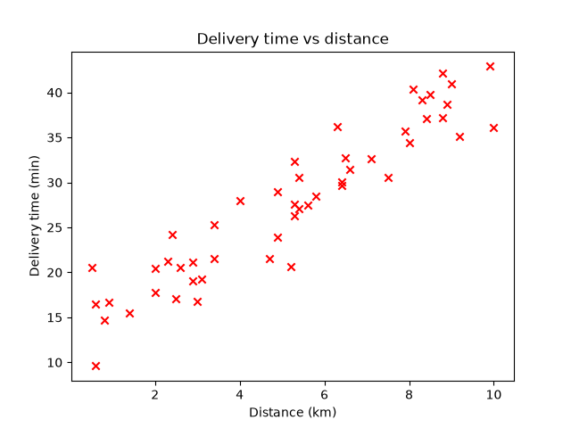

# Step 3: The training set

**The case:** a food delivery app must estimate the delivery time of an order
(say, a customer 6.5 km away) before the courier leaves. To do that, it learns
from past deliveries, where it knows the distance and how long each one
actually took.

Learning from examples that include the right answer is **supervised
learning**. Since the answer is a number (minutes), it is a **regression**
problem. The past deliveries are the **training set**:

| Term | Symbol | Here |
|---|---|---|
| Input (feature) | `x` | distance in km |
| Output (target) | `y` | delivery time in minutes |
| Number of examples | `m` | 50 |

In `src/machine_learning_from_scratch/data.py` they are stored in NumPy arrays:

```python
x = np.array([0.5, 0.6, 0.6, ...])   # distances
y = np.array([20.5, 16.5, 9.6, ...])  # times
```

In math, the first example is written $(x^{(1)}, y^{(1)})$.

```bash
uv run scripts/03_training_set.py
```

Plotting the training set shows the relationship. The library is
[matplotlib](https://matplotlib.org/), added with `uv add matplotlib`.

```python
plt.scatter(x, y, marker="x", color="red")
plt.savefig("figures/training_set.png")
```



Each cross is one delivery, one row of the training set. The farther the
delivery, the longer it takes, and the points follow roughly a straight line.
Fitting that line to the data is what comes next.

---

[← Step 2: Workspace structure](02-workspace.md) · [Step 4: The model →](04-model.md)
