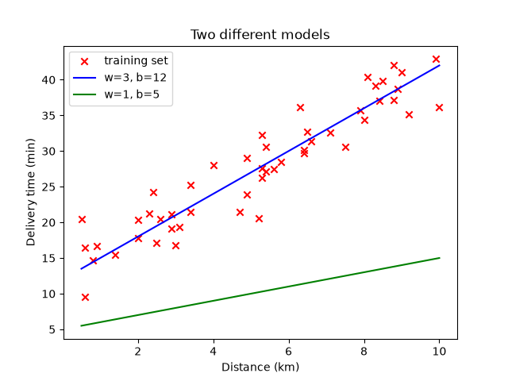

# Step 5: Drawing the model

A line is just the model's prediction for every distance. `scripts/05_plot_model.py`
draws two of them over the training set:

```python
plt.scatter(x, y, marker="x", color="red")
plt.plot(x, predict(x, w=3, b=12), color="blue")
plt.plot(x, predict(x, w=1, b=5), color="green")
```

```bash
uv run scripts/05_plot_model.py
```



The blue line (`w=3, b=12`) passes through the middle of the points. The green
line (`w=1, b=5`) sits far below them and predicts times that are too short
for every delivery. Seeing this by eye is easy. A computer needs a number that
says how bad a line is, and that number is the **cost function**.

---

[← Step 4: The model](04-model.md) · [Step 6: The cost function →](06-cost.md)
