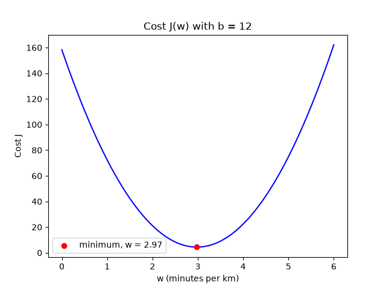

# Step 7: The shape of the cost

The cost depends on both `w` and `b`. To plot it, `b` is fixed at 12 and the
cost is computed for many values of `w`, in `scripts/07_plot_cost.py`:

```python
ws = np.linspace(0, 6, 100)  # 100 values of w between 0 and 6
costs = [compute_cost(x, y, w, b) for w in ws]
```

```bash
uv run scripts/07_plot_cost.py
```

```
lowest cost with b=12: w = 2.97
```



Each point on the curve is one line. The curve is a **U shape**, a bowl with a
single lowest point:

- Far from the bottom (`w` too small or too large), the line fits badly and
  the cost is high.
- At the bottom, around `w = 3`, the cost is minimal. That is the best slope
  for this `b`, close to the 3 minutes per km used to generate the data.

Finding the lowest point of this bowl is exactly what learning means. Trying
100 values of `w` by brute force works for one parameter, but not for `w` and
`b` together, or for models with thousands of parameters. Those require a method
that walks down the bowl on its own: **gradient descent**.

---

[← Step 6: The cost function](06-cost.md) · [Step 8: Gradient descent, one step →](08-gradient-step.md)
