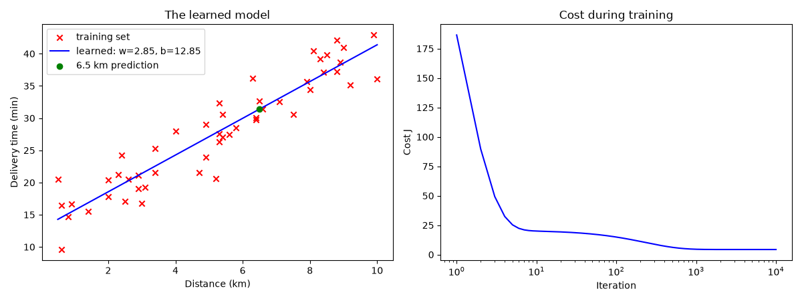

# Step 10: Visualizing the result

`scripts/10_plot_result.py` trains the model and draws two plots side by side.

```bash
uv run scripts/10_plot_result.py
```



**Left: the learned model.** The blue line (`w = 2.85, b = 12.85`) runs through
the middle of the training set, a good fit to the data. The green dot is the
answer to the original question: a delivery 6.5 km away is predicted at about
31 minutes.

**Right: the cost during training.** It falls steeply in the first few
iterations and then flattens out around iteration 1,000. The horizontal axis
uses a logarithmic scale (each tick is 10 times the previous one), because most
of the progress happens in the first steps, and the log scale keeps them
visible. A curve that goes down and then stays flat is the sign of a healthy
training run. Watching this plot is the standard way to check that gradient
descent is working.

---

[← Step 9: Gradient descent in a loop](09-gradient-descent.md) · [Step 11: Automated tests →](11-tests.md)
