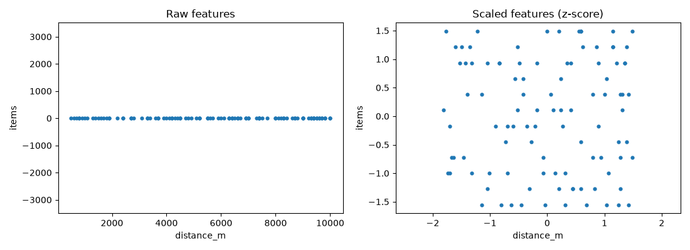

# Step 15: Feature scaling

[Step 14](14-multiple-gradient-descent.md) left a problem open: trained on the raw
deliveries, gradient descent barely learned anything, even after 100,000
iterations. The cause is the scale of the features.

## The problem

| Feature | Range |
|---|---|
| `distance_m` | 500 to 10,000 |
| `items` | 1 to 12 |
| `rush_hour` | 0 or 1 |

The prediction is a sum of terms `wⱼ · xⱼ`. A feature with large values needs a
small weight to keep its contribution reasonable, and a feature with small values
needs a large one. The true weights show it: 0.003 minutes per meter, against 7
minutes for the rush hour.

This matters for gradient descent because the derivative of each weight is multiplied
by the values of its feature. The distance has values up to 10,000, so a tiny change
in its weight changes the cost a lot; the rush hour needs a change thousands of times
larger to have the same effect. On a contour plot of the cost, this makes tall and
skinny ellipses, and gradient descent bounces from side to side along the way to
the minimum.

A single `alpha` is shared by all weights, so it is too large for the distance
(the training diverges) or too small for everything else (they barely move). That
is exactly what happened in Step 14.

**Feature scaling** transforms the features so they all have comparable ranges. The
contours become closer to circles, and gradient descent can take a direct path to
the minimum.

## Methods

Three common ways to rescale a feature `x`, using its mean `μ`, its largest and
smallest values, and its standard deviation `σ`:

| Method | Formula | Result |
|---|---|---|
| Divide by the maximum | `x / max` | between 0 and 1 (for positive features) |
| Mean normalization | `(x - μ) / (max - min)` | centered on 0, roughly between -1 and 1 |
| **Z-score** | `(x - μ) / σ` | mean 0 and standard deviation 1 |

Z-score is the one used here.

### When is scaling needed?

The aim is to bring each feature to roughly the range -1 to +1, but the limits are
loose:

| Range of a feature | Action |
|---|---|
| -3 to +3, or -0.3 to +0.3 | fine as it is |
| 0 to 3, or -2 to +0.5 | fine; rescaling is optional |
| -100 to +100 | rescale: too wide |
| -0.001 to +0.001 | rescale: too small |
| 98.6 to 105 (a body temperature in °F) | rescale: a narrow range, but large values |

There is almost never any harm in scaling. When in doubt, scale.

## Implementation

In `src/machine_learning_from_scratch/scaling.py`:

```python
def zscore_normalize(X):
    mu = X.mean(axis=0)
    sigma = X.std(axis=0)
    if np.any(sigma == 0):
        raise ValueError("a feature is constant (standard deviation 0); remove it before scaling")
    return (X - mu) / sigma, mu, sigma


def apply_zscore(x, mu, sigma):
    return (x - mu) / sigma


def unscale_parameters(w_scaled, b_scaled, mu, sigma):
    w = w_scaled / sigma
    b = b_scaled - np.sum(w_scaled * mu / sigma)
    return w, b
```

- `zscore_normalize` scales every column of the table and **returns the mean and the
  standard deviation** it used. A constant feature has `σ = 0`, which cannot be
  divided by, so it raises an error.
- `apply_zscore` scales new examples. They must use the `μ` and `σ` of the
  **training set**, not their own: the model learned parameters for that scale.
- `unscale_parameters` converts the parameters learned on scaled features back to the
  original units. Substituting `x_scaled = (x - μ) / σ` into the model gives

$$f(x) = \sum_j w'_j \frac{x_j - \mu_j}{\sigma_j} + b' = \sum_j \frac{w'_j}{\sigma_j}\,x_j + \left(b' - \sum_j \frac{w'_j\,\mu_j}{\sigma_j}\right)$$

so each original weight is `w'ⱼ / σⱼ`, and the new bias is the expression in
parentheses.

## Running it

```bash
uv run scripts/15_feature_scaling.py
```

```
features: ['distance_m', 'items', 'rush_hour']
range of each feature (max - min)
  raw:    [9.5e+03 1.1e+01 1.0e+00]
  scaled: [3.3  3.04 2.07]
mean of the scaled features: [0. 0. 0.]
std of the scaled features:  [1. 1. 1.]

largest stable alpha, raw features:    4.9e-08
largest stable alpha, scaled features: 1.87

alpha = 0.1, 1,000 iterations on the scaled features
  cost within 0.001 of the minimum (4.241) after 65 iterations
  scaled parameters: w = [8.775 3.808 3.327], b = 37.30

parameters in the original units
  learned: w = [3.0000e-03 1.0524e+00 6.8911e+00], b = 10.39
  exact:   w = [3.0000e-03 1.0524e+00 6.8911e+00], b = 10.39
  rule:    w = [3.0e-03 1.2e+00 7.0e+00], b = 10.0

new delivery [6.5e+03 4.0e+00 1.0e+00]
  scaled with the training mean and std: 41.29 min
  original parameters, no scaling:       41.29 min
  scaled parameters on the raw example:  57093 min  <- mistake
```



On the left, the two features on equal axes: the distance spans 9,500 and the items
span 11, so the points collapse onto a line. On the right, after the z-score, both
features spread over a similar range.

What the output shows:

| | Raw features (Step 14) | Scaled features |
|---|---|---|
| Largest stable `alpha` | 4.9e-8 | 1.87 |
| `alpha` used | 1e-8 | 0.1 |
| Iterations | 100,000, and the cost was still 57.3 | **65** to be within 0.001 of the minimum |
| Final cost | 57.3 | 4.241, the lowest possible |

- The **largest stable `alpha`** is the value above which gradient descent diverges
  (2 divided by the largest curvature of the cost, computed in the script). Scaling
  raised it from 4.9e-8, the "about 5e-8" of Step 14, to 1.87, a factor of tens of
  millions. With the larger `alpha = 0.1`, the training reaches the minimum in 65
  iterations.
- **Converted back to the original units, the parameters match the exact solution**
  from the normal equation to the digits shown.
- The scaled weights are comparable with each other: 8.8, 3.8 and 3.3 are the minutes
  added by one standard deviation of each feature (distance, items, rush hour).
- A **new delivery** must be scaled with the training `μ` and `σ` before using the
  scaled parameters (41.29 min). Using the original parameters directly on the raw
  example gives the same value. Mixing them up, scaled parameters on a raw example,
  gives 57,093 minutes.

## Tests

Seven tests in `tests/test_scaling.py`:

- the z-score checked by hand: for `[[1, 10], [3, 30]]` the means are `[2, 20]`, the
  standard deviations are `[1, 10]`, and the result is `[[-1, -1], [1, 1]]`;
- the scaled deliveries have mean 0 and standard deviation 1;
- a new example is scaled with the training mean and standard deviation (the average
  example becomes `[0, 0]`);
- a constant feature raises an error;
- unscaled parameters give the same predictions as the scaled ones;
- with scaling, 200 iterations reach the minimum, while the raw features, with their
  best `alpha`, stay far from it;
- training on scaled features finds the exact solution once converted back.

Together with the earlier tests, `uv run pytest` reports `24 passed`.

---

[← Step 14: Gradient descent with multiple features](14-multiple-gradient-descent.md) · [Step 16: Learning curve and choosing alpha →](16-learning-curve.md)
