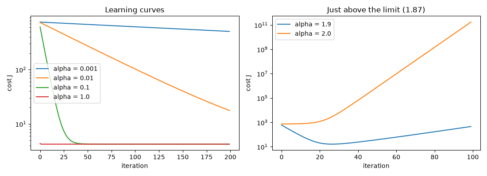

# Step 16: Learning curve and choosing alpha

[Step 15](15-feature-scaling.md) picked `alpha = 0.1` and 1,000 iterations without
saying how. Two questions remain: how to tell whether gradient descent is working,
and when to stop it.

## The learning curve

A **learning curve** plots the cost `J` after each iteration. `gradient_descent`
already returns that list (`costs`), so the curve costs nothing extra.

- With a correct gradient and a good `alpha`, `J` **goes down after every iteration**.
- If `J` goes up, either `alpha` is too large (the steps overshoot the minimum) or
  the gradient has a bug.
- When the curve flattens, gradient descent has converged.

The number of iterations needed varies a lot between problems, so the curve is the
way to find out, not a fixed number.

## Convergence test

An automatic way to decide when to stop: choose a small `epsilon` (here `0.001`) and
declare convergence when the cost changes by less than `epsilon` in one iteration.

Choosing `epsilon` is itself hard, so in practice the curve is the main tool, and the
test is a complement.

## Choosing alpha

Try several values, each about 3 times the previous one (0.001, 0.003, 0.01, 0.03,
...), run a few iterations of each and compare the curves. Keep the **largest `alpha`
for which the cost still goes down steadily**, or one slightly smaller.

Debugging checklist from the same lesson:

- with a very small `alpha`, the cost must still go down at every iteration; if it
  does not, the code has a bug;
- `alpha` too small: converges, but slowly;
- `alpha` too large: the cost oscillates or grows.

## Implementation

In `src/machine_learning_from_scratch/convergence.py`:

```python
def is_decreasing(costs, tolerance=1e-9):
    return all(later <= earlier + tolerance for earlier, later in zip(costs, costs[1:]))


def converged_at(costs, epsilon):
    for i in range(1, len(costs)):
        if abs(costs[i - 1] - costs[i]) < epsilon:
            return i
    return None
```

- `is_decreasing` is the debugging check: the cost never went up. The `tolerance`
  ignores rounding noise once the cost sits at the minimum.
- `converged_at` returns the first iteration whose cost changed by less than
  `epsilon`, or `None` if the cost was still moving at the end. It uses the absolute
  change, so an oscillating cost is not mistaken for progress.

## Running it

```bash
uv run scripts/16_learning_curve.py
```

```
200 iterations on the scaled features, epsilon = 0.001
  alpha   final cost     never up  converged at
  0.001        504.4         True          None
  0.003        228.9         True          None
   0.01        17.71         True          None
   0.03        4.245         True           176
    0.1        4.241         True            57
    0.3        4.241         True            19
    1.0        4.241         True             2
    1.9    9.213e+04        False          None
    2.0     1.36e+22        False          None
```



On the left, the learning curves for four values of `alpha` (log scale on the cost).
On the right, the two values above the limit of 1.87 found in Step 15: they diverge.

What the output shows:

- `0.001` to `0.01` are too small: the cost goes down, but after 200 iterations it is
  still far from the minimum (4.241).
- `0.03` to `0.3` converge, and the larger the value, the earlier: 176, 57 and 19
  iterations.
- `1.0` converges in 2 iterations. With scaled features the cost is almost round, so
  one step of this size lands almost on the minimum.
- `1.9` goes down at first and then climbs back up, and `2.0` explodes. This agrees
  with the largest stable `alpha` of 1.87 computed in Step 15.

The convergence test would stop `alpha = 0.03` after 176 iterations, close to the
minimum (4.245 against 4.241).

## Tests

Five tests in `tests/test_convergence.py`:

- `is_decreasing` on hand-made curves, one falling and one with a bump;
- `converged_at` on `[10, 5, 2, 1.9995, 1.9994]` stops at index 3, the first change
  below 0.001;
- `converged_at` returns `None` while the cost is still moving;
- `alpha = 0.1` never goes up and `alpha = 2.0` does;
- on the deliveries, `0.03`, `0.1` and `0.3` converge in a decreasing number of
  iterations.

Together with the earlier tests, `uv run pytest` reports `29 passed`.

---

[← Step 15: Feature scaling](15-feature-scaling.md) · [Step 17: Feature engineering and polynomial regression →](17-feature-engineering.md)
