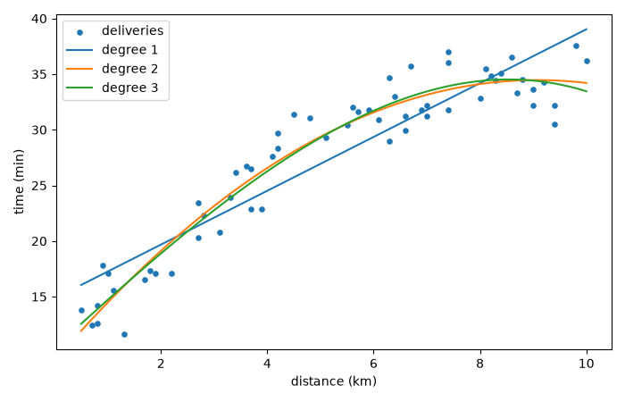

# Step 17: Feature engineering and polynomial regression

So far the model is a straight line in each feature: the prediction is
`w₁x₁ + w₂x₂ + ... + b`. Two techniques make the same algorithm fit richer patterns
without changing `predict`, the cost or gradient descent. Only the **columns of the
table** change.

## Feature engineering

**Feature engineering** creates new features from the existing ones, using knowledge
about the problem. Example: in the rush hour, every meter takes longer, not just a
fixed penalty. The effect of the distance depends on the rush hour, which a plain sum
cannot express. A new feature fixes that:

```
distance_x_rush = distance_m * rush_hour
```

The model becomes `w₁·distance + w₂·items + w₃·rush + w₄·(distance × rush) + b`. It is
still **linear in the parameters**, so everything from the previous steps applies.

## Polynomial regression

To fit a curve, add powers of a feature as columns: `x`, `x²`, `x³`, ... The model
`w₁·x + w₂·x² + b` draws a parabola, yet it is again a linear model of the columns.

Powers grow fast: for a distance up to 10 km, the columns `x`, `x²`, `x³` reach 10,
100 and 1,000. That is the scale problem of [Step 15](15-feature-scaling.md) again,
created by the new columns themselves, so they must be scaled too.

## Implementation

In `src/machine_learning_from_scratch/features.py`:

```python
def add_interaction(X, i, j):
    return np.column_stack([X, X[:, i] * X[:, j]])


def polynomial_features(x, degree):
    return np.column_stack([x**d for d in range(1, degree + 1)])
```

The data for the examples:

- `make_deliveries(rush_slowdown=0.002)` in `data_multiple.py`: the same deliveries,
  plus 0.002 min per meter in the rush hour. With the default `0.0` nothing changes,
  so the earlier steps give the same results.
- `make_curved_deliveries()` in the new `data_curved.py`: 60 deliveries whose time
  follows `10 + 5·km − 0.25·km²` plus noise, so it grows ever more slowly.

## Running it

```bash
uv run scripts/17_feature_engineering.py
```

```
deliveries where rush hour adds 0.002 min per meter
  3 features                       cost = 7.354
  3 features + distance*rush_hour  cost = 4.210
  noise floor (std 3.0 -> J about 4.5)

curved deliveries, time against distance in km
  degree 1: cost =  4.252   w = [2.4189], b = 14.84
  degree 2: cost =  1.964   w = [ 5.5602 -0.3062], b = 9.22
  degree 3: cost =  1.963   w = [ 4.3956 -0.0369 -0.0172], b = 10.37
  rule: 10 + 5*km - 0.25*km**2

range of the columns km, km**2, km**3: [  10.  100. 1000.]
  raw columns, alpha = 1e-4:                  cost = 1.11e+236  (diverges)
  raw columns, alpha = 1e-6, 5000 iterations: cost = 89.04
  scaled columns, alpha = 0.1, 5000 iterations: cost = 1.963
```



What the output shows:

- The **interaction column** drops the cost from 7.35 to 4.21, to about the noise
  level of the data (the lowest cost with noise of standard deviation 3 is near 4.5).
  The straight-line model could not reach that, no matter how long it trained.
- A **line** leaves a cost of 4.25 on the curved data. The **parabola** halves it
  (1.96) and follows the curve in the figure. The noise has standard deviation 2, so
  1.96 is again about the floor.
- **Degree 3 is no better than degree 2** (1.963 against 1.964): the data is a
  parabola, so the extra column adds nothing. More columns always lower the training
  cost a little, which does not make the model better; this is the subject of the
  next week of the course.
- The learned coefficients of the parabola (5.56 and −0.31) differ from the rule
  (5 and −0.25) because of the noise and because `b` and the `x` weight compensate
  each other.
- **Without scaling** the polynomial columns break gradient descent: `alpha = 1e-4`
  diverges, and the safe `alpha = 1e-6` is still at cost 89 after 5,000 iterations.
  With scaling, `alpha = 0.1` reaches 1.963.
- Degree 3 needs about 20,000 iterations to reach the last digits of the minimum
  (1.953): `x`, `x²` and `x³` are strongly correlated, even after scaling, and
  gradient descent is slow along that direction.

## Tests

Six tests in `tests/test_features.py`:

- `add_interaction` and `polynomial_features`, each checked by hand (two tests);
- the interaction feature brings the best possible cost from above 7 to below 4.5;
- the squared feature at least halves the cost of the line on the curved data;
- gradient descent on scaled degree-2 features reaches the best possible cost;
- the raw degree-3 columns diverge with an `alpha` of `1e-4`.

Together with the earlier tests, `uv run pytest` reports `35 passed`.

---

[← Step 16: Learning curve and choosing alpha](16-learning-curve.md)
