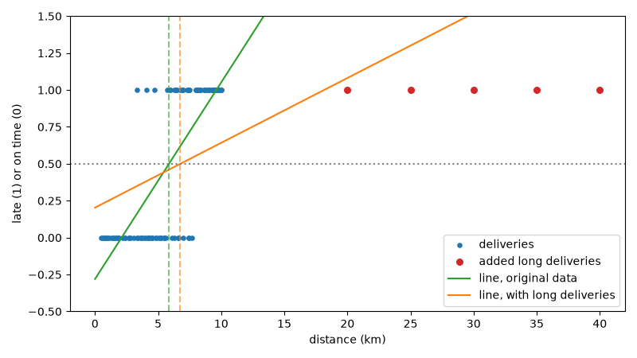
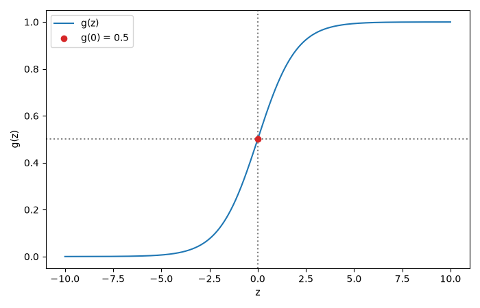

# Step 18: Classification and the sigmoid function

Until now the model predicted a **number**: minutes, a price. Many problems ask for a
**category** instead: is the email spam, is the transaction fraudulent, will the
delivery be late. When there are two possible answers, the problem is called **binary
classification**, and the answer (the label `y`) is written as `0` or `1`:

- `0`: the **negative** class (on time);
- `1`: the **positive** class (late).

The data for this week is a variation of the deliveries: `make_late_deliveries()` in
the new `data_classification.py` generates the distance and the number of items, and
labels a delivery `1` when its time goes beyond 35 minutes (the time itself is not
part of the data, only the label). With the default seed, 48 of the 100 deliveries
are late.

## Why linear regression does not work here

The first idea is to reuse the model of the previous steps: fit a line to the 0/1
labels and say "late" when the line is at least 0.5. It fails in two ways.

1. **The output is not a probability.** A line goes below 0 and above 1, but a
   probability cannot.
2. **A few easy points move the boundary.** A delivery of 40 km is certainly late, and
   a good model would not change its mind because of it. A line is pulled by every
   point, including the ones it already classifies correctly.

## Running it: the line that fails

```bash
uv run scripts/18_linear_regression_fails.py
```

```
late (1) or on time (0), predicted by a straight line on the distance
  line: 0.133 * km + (-0.280)
  at 0 km the line says -0.28, at 10 km it says 1.05  (not between 0 and 1)
  crosses 0.5 at 5.86 km, accuracy = 88%

the same line after adding 5 deliveries of 20 to 40 km (all late)
  crosses 0.5 at 6.76 km  (moved by +0.90 km)
  accuracy on the original deliveries = 85%
```



What the output shows:

- The line says −0.28 at 0 km and 1.05 at 10 km, outside the range of a probability.
- The five added deliveries are all late and far beyond the rest, so they should not
  matter. Still, they flatten the line and move the point where it crosses 0.5 from
  5.86 km to 6.76 km. The accuracy on the original deliveries drops from 88% to 85%.
- The distance alone is also a weak predictor: the items count matters too. The 88%
  is not the limit of the idea, only of this demonstration.

## The sigmoid function

The fix is to keep the linear part and pass its result through a function that
squeezes any number into the range from 0 to 1. The **sigmoid** (or logistic function)
does that:

```
g(z) = 1 / (1 + e^-z)
```

- for a very negative `z`, `e^-z` is huge and `g(z)` is almost `0`;
- for `z = 0`, `g(0) = 1 / (1 + 1) = 0.5` exactly;
- for a very positive `z`, `e^-z` is almost `0` and `g(z)` is almost `1`.

It never reaches 0 or 1, it always grows with `z`, and it is symmetric:
`g(−z) = 1 − g(z)`. The output can be read as the **probability that the label is 1**.
Next step it receives `z = w·x + b`.

## Implementation

In `src/machine_learning_from_scratch/logistic.py`:

```python
def sigmoid(z):
    # clip keeps e^-z from overflowing when z is very negative
    return 1 / (1 + np.exp(-np.clip(z, -500, 500)))
```

It works for a single number and for a whole array, because `np.exp` acts on each
element. Without the `np.clip`, `z = -1000` asks for `e^1000`, which does not fit in a
floating-point number and raises an overflow warning. Limiting `z` to ±500 changes no
result: `g(500)` is already `1.0` in floating point.

## Running it: the sigmoid

```bash
uv run scripts/18_sigmoid.py
```

```
sigmoid(z) for a few values of z
  z = -10  ->  g(z) = 0.00005
  z =  -4  ->  g(z) = 0.01799
  z =  -2  ->  g(z) = 0.11920
  z =  -1  ->  g(z) = 0.26894
  z =   0  ->  g(z) = 0.50000
  z =   1  ->  g(z) = 0.73106
  z =   2  ->  g(z) = 0.88080
  z =   4  ->  g(z) = 0.98201
  z =  10  ->  g(z) = 0.99995

range of g over z in [-10, 10]: 0.00005 to 0.99995
g(z) >= 0.5 exactly when z >= 0: True
```



What the output shows:

- The values stay strictly between 0 and 1, and the curve is steepest around `z = 0`
  and flat on both ends.
- `g(z) ≥ 0.5` exactly when `z ≥ 0`. This is what turns a probability into a decision
  in the next step: "late" when `w·x + b ≥ 0`.

## Tests

Ten new tests.

In `tests/test_logistic.py` (six):

- `g(0)` is exactly 0.5;
- `g(−1)`, `g(1)` and `g(2)` match values calculated by hand;
- the symmetry `g(−z) = 1 − g(z)`;
- the output stays strictly between 0 and 1 and always grows;
- `g(−1000)` and `g(1000)` raise no overflow warning (the test turns any warning into
  an error);
- an array of shape `(3, 4)` comes back with shape `(3, 4)`.

In `tests/test_data_classification.py` (four):

- the shapes are `(100, 2)` and `(100,)`, and the labels are only 0 or 1;
- the same seed gives the same data;
- both classes are common (the late share is between 30% and 70%);
- long deliveries are late more often than short ones.

Together with the earlier tests, `uv run pytest` reports `45 passed`.

---

[← Step 17: Feature engineering and polynomial regression](17-feature-engineering.md) · [Step 19: The logistic model and the decision boundary →](19-logistic-model.md)
