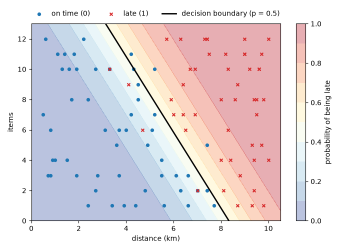

# Step 19: The logistic model and the decision boundary

[Step 18](18-classification-and-sigmoid.md) ended with the sigmoid. The **logistic
regression** model is the linear model of the earlier steps passed through it:

```
z = w · x + b
f(x) = g(z) = 1 / (1 + e^-z)
```

`f(x)` is a number between 0 and 1, read as the **probability that the label is 1**. If
`f(x) = 0.7`, the model says the delivery is late with 70% probability. The parameters
`w` and `b` are the same kind of thing as before, and the dot product `w · x` is the
`np.dot` of [Step 13](13-vectorization.md).

## From probability to decision

To get a label, compare the probability with a **threshold**, usually 0.5:

```
ŷ = 1  if f(x) ≥ 0.5
ŷ = 0  otherwise
```

Since `g(z) ≥ 0.5` exactly when `z ≥ 0` (see Step 18), this is the same as asking
whether `w · x + b ≥ 0`. The set of points where `w · x + b = 0` is the **decision
boundary**: on one side the model answers 1, on the other it answers 0. With two
features it is a straight line, and on it the probability is exactly 0.5.

## Implementation

In `src/machine_learning_from_scratch/logistic.py`, next to `sigmoid`:

```python
def predict_proba(X, w, b):
    return sigmoid(np.dot(X, w) + b)


def predict_class(X, w, b, threshold=0.5):
    return (predict_proba(X, w, b) >= threshold).astype(int)
```

Both accept one example `(n,)` or many `(m, n)`, like `predict` in
[Step 4](04-model.md) and [Step 12](12-multiple-features.md). The threshold can be
changed: a higher one answers "late" only when the model is more sure.

## Running it

The script uses the 100 late/on-time deliveries with the columns `[km, items]` and
parameters chosen **by hand**, not trained: `z = 0.9·km + 0.36·items − 7.5`. Training
is the subject of the next steps.

```bash
uv run scripts/19_logistic_model.py
```

```
probability of being late, w = [0.9, 0.36], b = -7.5
  2 km,  3 items  ->  0.010
  5 km,  6 items  ->  0.302
  8 km, 10 items  ->  0.964

same decision from 'probability >= 0.5' and 'z >= 0': True
accuracy on the 100 deliveries: 93%
predicted late: 47, really late: 48

on the boundary line, z = 0 and the probability is exactly 0.5:
  4 km, 10.83 items  ->  0.500
  6 km,  5.83 items  ->  0.500
```



What the output shows:

- A short delivery with few items gets a probability near 0 (0.010), a long one with
  many items near 1 (0.964), and a medium one stays in between (0.302).
- Deciding by "probability ≥ 0.5" or by "`z ≥ 0`" gives the same label for every
  delivery.
- The black line in the figure is the decision boundary, where `z = 0`: solving for
  the items gives `items = (7.5 − 0.9·km) / 0.36`. The colors show the probability,
  which changes gradually around the line instead of jumping.
- With these hand-picked values the accuracy is already 93%. The labels come from a
  noisy rule, so a few deliveries near the line end on the wrong side whatever the
  parameters.

## Tests

Six new tests in `tests/test_logistic.py`:

- `predict_proba` against a hand calculation (`z = 0.5`, `g = 0.6225`);
- many examples at once give the same as one by one;
- the probability is exactly 0.5 on the points of the boundary line;
- `predict_class` is 1 exactly when `z ≥ 0`, checked on 200 random examples;
- a point exactly on the boundary is class 1;
- a higher threshold turns borderline answers into 0.

Together with the earlier tests, `uv run pytest` reports `51 passed`.

---

[← Step 18: Classification and the sigmoid function](18-classification-and-sigmoid.md) · [Step 20: The logistic cost function →](20-logistic-cost.md)
