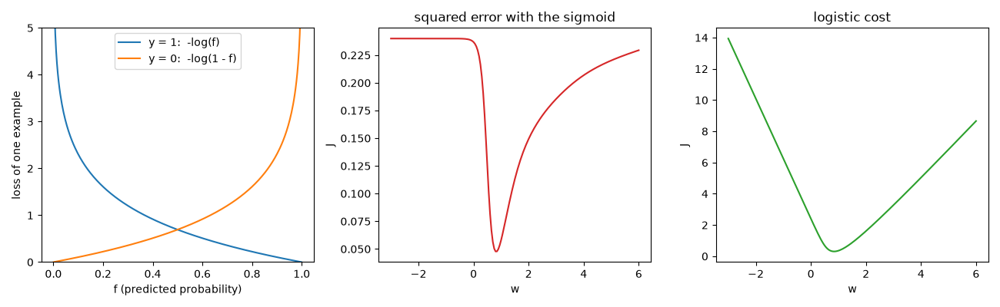

# Step 20: The logistic cost function

Training the logistic model needs a cost, as in [Step 6](06-cost.md): one number that
says how badly `w` and `b` fit the data, and that gradient descent can lower.

## Why not the squared error

The squared error of Step 6 still compiles with the new model, but it is a bad choice.
Passing the line through the sigmoid turns the cost into a curve with a **flat
plateau**: where the model is very wrong and very sure of itself, the sigmoid is
flat, the derivative is almost zero and gradient descent barely moves. The curve also
bends the wrong way in places, so it is not a single bowl with one minimum.

## The logistic loss

The cost for classification is built from the **loss of one example**, which depends
on the label:

```
loss(f, y) = -log(f)        if y = 1
loss(f, y) = -log(1 - f)    if y = 0
```

where `f` is the predicted probability. Read it as a penalty on surprise: if the label
is 1, the loss is near 0 when `f` is near 1 and grows without limit as `f` goes to 0.
The two cases fit in one line, and the cost is the average over the `m` examples:

```
loss(f, y) = -y·log(f) - (1 - y)·log(1 - f)

J(w, b) = (1/m) · Σ loss(f(xᵢ), yᵢ)
```

When `y = 1` the second term vanishes, and when `y = 0` the first one does. This cost
is **convex** for logistic regression: one bowl, no local minimum, which is the
property gradient descent needs.

## Implementation

In `src/machine_learning_from_scratch/logistic.py`:

```python
def compute_cost_logistic(X, y, w, b):
    z = np.dot(X, w) + b
    loss = np.logaddexp(0, z) - y * z
    return loss.mean()
```

This is not the formula above typed literally. With `f = g(z)`, a bit of algebra gives
the same loss in terms of `z`: `log(1 + e^z) - y·z`. The reason is numerical. If the
model is very sure and wrong, `f` becomes exactly `0.0` or `1.0` in floating point, and
the plain formula takes `log(0)`, which is `-inf` and ruins the whole cost.
`np.logaddexp(0, z)` computes `log(1 + e^z)` without overflow and never takes
`log(0)`, so it stays correct for any `z`.

## Running it

```bash
uv run scripts/20_logistic_cost.py
```

```
loss of one example
   f    y = 1    y = 0
  0.99    0.010    4.605
  0.90    0.105    2.303
  0.50    0.693    0.693
  0.10    2.303    0.105
  0.01    4.605    0.010

cost of a small problem (6 examples), w = [1, 1]
  b = -3.0: J = 0.3669
  b = -4.0: J = 0.5037

one example with y = 0 and z = 40 (f = 1.0, so 1 - f = 0.0)
  plain formula:         inf   (log of 0)
  compute_cost_logistic: 40.0

cost along w (distance only, b = -5)
  squared error: lowest 0.048 at w = 0.80, flat at 0.240 for w < -1
  logistic:      lowest 0.307 at w = 0.85, 13.9 at w = -3
  places where the curve bends the wrong way: squared 151, logistic 0
```



What the output shows:

- When the label is 1, a probability of 0.99 costs 0.010 and a probability of 0.01
  costs 4.605. The penalty grows quickly for a confident wrong answer. At `f = 0.5`
  both labels cost `log 2 = 0.693`, the cost of not knowing.
- The two sets of parameters of the small problem give 0.3669 and 0.5037: `b = -3`
  fits better than `b = -4`, and the cost tells which.
- The plain formula returns `inf` for a confident wrong answer, while the rewritten one
  returns the correct 40.
- In the figure, the **squared error** (middle) is flat at 0.24 for every `w` below
  zero: from there gradient descent would receive a gradient near zero and not know
  where to go. The **logistic cost** (right) is a smooth bowl whose slope always points
  towards the minimum. The two minima are near the same `w` (0.80 and 0.85), but only
  one of the curves is a good road to it. The heights differ because they measure
  different things.

## Tests

Seven tests in `tests/test_logistic_cost.py`:

- one example with `f = 0.5` costs `log 2`, for both labels;
- a confident right and a confident wrong answer, calculated by hand (0.1269 and
  2.1269);
- the cost of the six-point problem: 0.3669 and 0.5037;
- the cost agrees with the plain formula on the deliveries;
- the cost is positive, small for a good fit and larger for the opposite answers;
- all-zero parameters give `log 2`;
- extreme probabilities raise no overflow, division by zero or invalid-value warning
  (a flat `log(0)` would).

Together with the earlier tests, `uv run pytest` reports `58 passed`.

---

[← Step 19: The logistic model and the decision boundary](19-logistic-model.md) · [Step 21: Gradient descent for logistic regression →](21-logistic-gradient-descent.md)
