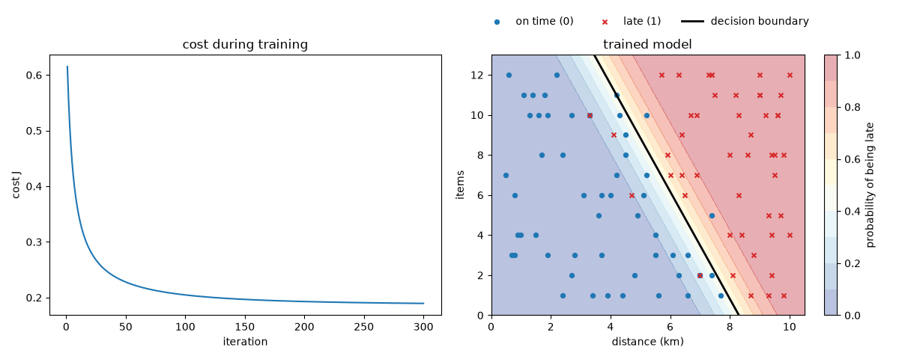

# Step 21: Gradient descent for logistic regression

With the model ([Step 19](19-logistic-model.md)) and the cost
([Step 20](20-logistic-cost.md)) ready, what is missing is the gradient. Then the loop
of [Step 9](09-gradient-descent.md) trains the model.

## The gradient

The derivatives of the logistic cost look exactly like those of linear regression:

```
∂J/∂wⱼ = (1/m) · Σ (f(xᵢ) - yᵢ) · xᵢⱼ
∂J/∂b  = (1/m) · Σ (f(xᵢ) - yᵢ)
```

The only difference is what `f` is: for linear regression `f(x) = w·x + b`, here
`f(x) = g(w·x + b)`. The rule of "error times input" is the same, and it is not a
coincidence: the loss of Step 20 is the one for which the sigmoid derivative cancels
out, leaving this simple form.

## Making gradient descent reusable

The `gradient_descent` function of Step 9 called the linear cost and gradient
directly. It now receives them as two optional arguments:

```python
def gradient_descent(
    x, y, w, b, alpha, num_iters, cost_function=compute_cost, gradient_function=compute_gradient
):
```

Functions are values in Python, so the loop does not need to know which model it is
training. Without the new arguments it behaves as before, and every earlier script and
test is untouched. For logistic regression:

```python
gradient_descent(X, y, w, b, alpha, num_iters, compute_cost_logistic, compute_gradient_logistic)
```

## Implementation

In `src/machine_learning_from_scratch/logistic.py`:

```python
def compute_gradient_logistic(X, y, w, b):
    m = len(X)
    errors = predict_proba(X, w, b) - y
    dj_dw = np.dot(X.T, errors) / m
    dj_db = errors.sum() / m
    return dj_dw, dj_db


def accuracy(X, y, w, b):
    return np.mean(predict_class(X, w, b) == y)
```

The return order is `(dj_dw, dj_db)`, the same as `compute_gradient` in
[Step 8](08-gradient-step.md). The cost says how well the probabilities fit, while
`accuracy` says in how many examples the final decision (0 or 1) is right. It is
easier to read, but it is not what the training lowers.

## Running it

The features are scaled first, as in [Step 15](15-feature-scaling.md), and the
learned parameters are converted back to the original units.

```bash
uv run scripts/21_logistic_gradient_descent.py
```

```
gradient of the small problem at w = [2, 3], b = 1
  dj_dw = [0.49833 0.49884], dj_db = 0.49862
  numerical derivative in b: 0.49862

logistic regression trained with gradient descent, alpha = 0.5
  iteration    1: J = 0.6149
  iteration   10: J = 0.3539
  iteration  100: J = 0.2047
  iteration 1000: J = 0.1870
  w = [1.708 0.637], b = -14.18   (per km and per item)
  accuracy = 93%
  cost: trained 0.1870, Step 19's hand-picked parameters 0.2269

without scaling, alpha = 0.1, 1000 iterations: J = 0.2646 (scaled: 0.1870)

new delivery, 6 km and 7 items: probability of being late = 0.628
  same probability with the unscaled parameters: 0.628
```



What the output shows:

- The analytical gradient agrees with a numerical derivative of the cost (0.49862),
  the same check used in [Step 14](14-multiple-gradient-descent.md).
- The cost falls from 0.6149 (close to `log 2 = 0.693`, the cost of not knowing) to
  0.1870, quickly at first and slowly after. The cost always decreases, as the
  learning curve of [Step 16](16-learning-curve.md) should.
- The trained parameters, `w = [1.708, 0.637]` and `b = -14.18`, have a lower cost
  than the hand-picked ones of Step 19 (0.1870 against 0.2269). The accuracy is 93% in
  both: the cost measures the confidence of the probabilities, which the accuracy
  does not see.
- The trained boundary in the figure leaves the same few deliveries on the wrong side:
  they are the noise of the labels, which no straight line can fix.
- Without scaling, the same number of iterations stops at 0.2646: the columns `km`
  and `items` have different ranges, and the scaled version reaches the minimum.
- A new delivery of 6 km and 7 items has a 62.8% probability of being late, with the
  scaled or the unscaled parameters.

## Tests

Eight new tests in `tests/test_logistic_gradient.py`:

- the gradient of a single example, by hand;
- the gradient of the six-point problem (0.49833, 0.49884 and 0.49862);
- the gradient matches a numerical derivative of the cost, for `w` and `b`;
- the gradient is zero when the labels equal the model's own probabilities;
- `accuracy` counts the right predictions (3 of 4 gives 0.75);
- `gradient_descent` without the new arguments gives the same result as passing
  the linear functions explicitly;
- the logistic cost goes down at every step, and starts below `log 2`;
- after training, the gradient is almost zero, the cost beats the hand-picked
  parameters and the accuracy is at least 90%.

Together with the earlier tests, `uv run pytest` reports `66 passed`.

---

[← Step 20: The logistic cost function](20-logistic-cost.md) · [Step 22: Overfitting and regularization →](22-regularization.md)
