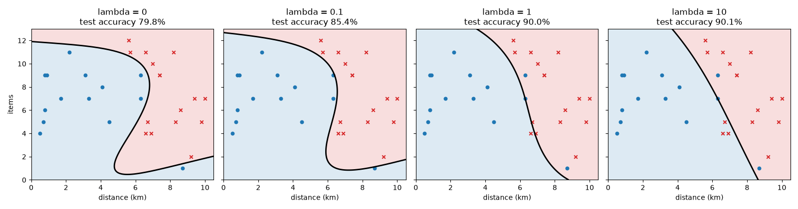

# Step 22: Overfitting and regularization

A model can fit the training data very well and still fail on new data. This step
shows how it happens and one way to prevent it.

## Underfitting and overfitting

- **Underfitting**: the model is too simple for the pattern, so it errs even on the
  training data. A straight line through the curved deliveries of
  [Step 17](17-feature-engineering.md) is an example.
- **Overfitting**: the model is flexible enough to memorize the training set, noise
  included. It is excellent on the data it saw and worse on new data.

Adding polynomial columns, as in Step 17, makes the model more flexible, which helps
when the pattern is complex and hurts when it is not. The cost on the training data
cannot tell the two cases apart, because it only goes down as the model gets more
flexible. What reveals overfitting is the performance on **data the training did not
use**: a **test set**.

Three common ways to reduce overfitting:

1. **More training data.** Often the best one, and often not available.
2. **Fewer features**, which removes flexibility by hand.
3. **Regularization**: keep the features but stop the weights from growing too large.

## Regularization

An overfit model usually has large weights: to bend the boundary through every point
it needs sharp contributions from the high-degree columns. Regularization adds to the
cost a **penalty on the size of the weights**:

```
J(w, b) = (cost as before) + (λ / 2m) · Σ wⱼ²
```

`λ` (lambda) sets how much the penalty matters. With `λ = 0` nothing changes. A larger
`λ` makes large weights expensive, so gradient descent has to find a compromise between
fitting the data and keeping the weights small. If `λ` is too large, every weight goes
to zero and the model underfits.

The derivative of the penalty is `(λ / m) · wⱼ`, so only the gradient of `w` changes:

```
∂J/∂wⱼ = (as before) + (λ / m) · wⱼ
∂J/∂b  = (as before)
```

The parameter `b` is **not** penalized: it only shifts the boundary and does not make
it more complex. The same two additions work for linear and logistic regression,
because they come from the penalty, not from the model.

Regularization treats all weights alike, which is fair only when the features have
similar scales. Another reason to scale them, as in [Step 15](15-feature-scaling.md).

## Implementation

Every cost and gradient function gets one more argument, `lambda_`, whose default
`0.0` keeps the old behavior. In `logistic.py`:

```python
def compute_cost_logistic(X, y, w, b, lambda_=0.0):
    z = np.dot(X, w) + b
    loss = np.logaddexp(0, z) - y * z
    return loss.mean() + lambda_ / (2 * len(X)) * np.sum(w**2)


def compute_gradient_logistic(X, y, w, b, lambda_=0.0):
    ...
    dj_dw = np.dot(X.T, errors) / m + lambda_ / m * w
```

`compute_cost` and `compute_gradient` (linear regression) change the same way. Nothing
changes in `gradient_descent`, which calls the functions as `function(x, y, w, b)`.
To train with a given `lambda_`, fix it with `functools.partial`:

```python
partial(compute_cost_logistic, lambda_=1.0)
```

The name is `lambda_` because `lambda` is a reserved word in Python.

To make a flexible model from the two features of the deliveries, `features.py` gets
`polynomial_features_2d(X, degree)`: all the products `km^i · items^j` with
`1 ≤ i + j ≤ degree`. Degree 2 gives `x₁, x₂, x₁², x₁x₂, x₂²`, and degree 6 gives 27
columns.

## Running it

The training set is **small on purpose**: 30 deliveries, against 27 features. The
model is evaluated on 1,000 other deliveries from the same generator with a different
seed. Features are scaled with the training set's mean and standard deviation.

```bash
uv run scripts/22_regularization.py
```

```
30 training deliveries, 1000 test deliveries, 27 polynomial features

logistic regression, 20,000 iterations
  lambda   train acc   test acc   train cost   test cost   sum of |w|
       0        100%      79.8%        0.020       0.761         70.7
     0.1        100%      85.4%        0.112       0.342         22.3
       1         87%      90.0%        0.212       0.253          6.2
      10         83%      90.1%        0.287       0.284          2.9

straight boundary (degree 1): train 83%, test 90.4%
```



What the output shows:

- With `λ = 0` the model gets **100% on the training set and 79.8% on the test set**.
  The test cost (0.761) is 38 times the training cost (0.020). This is overfitting.
  The first panel shows how: the boundary curls to leave every training point on the
  right side.
- A larger `λ` trades training accuracy (100% → 87%) for **test accuracy** (79.8% →
  90.0%). The sum of the weights falls from 70.7 to 6.2 and the boundary straightens.
- Too much is not better: from `λ = 1` to `λ = 10` the test accuracy stays the same
  while the training cost keeps going up (0.212 → 0.287), the start of underfitting.
- The straight boundary of the earlier steps, trained on the same 30 deliveries, gets
  90.4%. That is expected: the labels come from a straight rule, so a simple model is
  already the right one. In practice the right complexity is not known in advance,
  and regularization lets a flexible model act like a simple one when the data asks
  for it.
- With `λ = 0` the training does not stop in a minimum: the 30 points can be separated
  perfectly, so the cost keeps shrinking while the weights keep growing. The result
  depends on the number of iterations (20,000 here).
- `λ` itself is a choice, not learned by gradient descent. The usual way to pick it is
  to compare several values on data held out from training (a validation set), as the
  test set does here.

## Tests

Twelve new tests in `tests/test_regularization.py`:

- the penalty added to the linear and to the logistic cost, calculated by hand;
- `lambda_ = 0` changes nothing;
- the penalty ignores `b` (with `w = 0` the value of `λ` makes no difference);
- the gradient adds `(λ / m) · w` to `dj_dw` and nothing to `dj_db`, for both models;
- the regularized gradient matches a numerical derivative of the regularized cost
  (two tests, one for each model);
- a larger `λ` gives smaller weights after training;
- `polynomial_features_2d` by hand, the number of columns for several degrees, and
  degree 1 returning the original table (three tests);
- on the 30-delivery set, without the penalty the training accuracy is 100% and the
  test accuracy below 85%, and with `λ = 1` the test accuracy is at least 5 points
  better.

Together with the earlier tests, `uv run pytest` reports `78 passed`.

---

[← Step 21: Gradient descent for logistic regression](21-logistic-gradient-descent.md)
